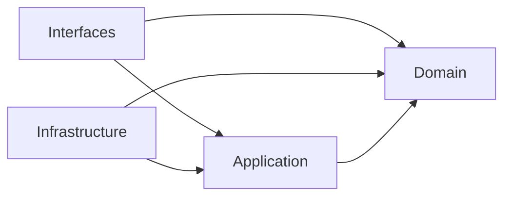

# Camadas e direção das dependências

Definição da issue [#14](https://github.com/mamura/bacurim-api/issues/14), dentro da #12. Complementa o [mapa dos contextos](context-map.md). Cada módulo de negócio usa as mesmas quatro camadas; o módulo continua sendo a fronteira principal de responsabilidade.

## Responsabilidades

| Camada | Responsabilidade | Conteúdo | Não pertence à camada |
| --- | --- | --- | --- |
| Domain | Vocabulário, comportamento e invariantes do contexto. | Entidades, objetos de valor, serviços de domínio e exceções de negócio. Contratos necessários ao próprio comportamento do domínio quando houver necessidade real. | Eloquent, facades, container Laravel, HTTP, configuração de ambiente, SQL e clientes externos. |
| Application | Coordenar uma operação da aplicação preservando as regras do domínio. | Casos de uso, entradas/saídas, portas de persistência e serviços externos, contratos públicos de integração, contexto autorizado e limites de transação. | Request/Response do Laravel, modelos ORM, SQL, acesso a env(), serviço global de autenticação ou detalhes de infraestrutura. |
| Infrastructure | Implementar portas e conectar mecanismos externos. | Repositórios Eloquent, modelos de persistência, adaptadores de serviços externos, consultas SQL, implementação de transações e Service Providers. | Decidir regras financeiras, expor modelos ORM como contratos ou fazer o domínio depender do Laravel. |
| Interfaces | Traduzir uma entrada externa em chamada de caso de uso e apresentar o resultado. | Controllers, Form Requests, Resources, rotas, comandos Artisan e adaptadores de entrada de jobs. | Calcular resultado financeiro, executar SQL, gravar diretamente em repositórios ou resolver invariantes apenas na validação HTTP. |

Uma entidade de domínio tem identidade e comportamento; não herda de Model do Eloquent. Objetos de valor representam conceitos sem identidade própria, validam sua construção e devem ser imutáveis quando aplicável. Serviços de domínio contêm comportamento que não pertence naturalmente a uma entidade ou objeto de valor; não são repositórios de funções utilitárias.

Casos de uso coordenam entidades, portas e políticas. Não devem duplicar invariantes das entidades, mas precisam validar precondições de aplicação, como contexto autorizado e existência de recursos. Um serviço de domínio não recebe o caso de uso ou o container para resolver dependências.

## Dependências permitidas

As setas representam dependência de código, não a sequência de chamadas em execução:



- Domain não depende das demais camadas, do framework ou de implementações de outros módulos.
- Application depende de Domain e de contratos públicos de Application de outros módulos, apenas nas arestas permitidas no mapa dos contextos.
- Infrastructure implementa contratos de Application ou Domain e pode usar Laravel e bibliotecas externas. Não importa Interfaces para executar operações de negócio.
- Interfaces depende dos casos de uso e dos tipos necessários para traduzi-los; pode conhecer tipos/exceções de Domain, mas não importa adaptadores ou modelos de Infrastructure.
- O ponto de composição é uma exceção explícita: bootstrap e providers conectam contratos e implementações. Providers de Infrastructure podem registrar rotas de Interfaces e fazer bindings, sem incluir regras de negócio. Não usar essa exceção dentro de controllers ou casos de uso.

Em execução, um caso de uso pode chamar um repositório, mas o código depende da interface definida na camada interna. O container injeta o adaptador externo. Injeção de dependências não significa chamar `app()` ou facades dentro de Domain/Application.

## Localização proposta

A estrutura física será criada na #15. Os caminhos abaixo usam o namespace PSR-4 existente `App\`, que já aponta para `app/`:

```text
app/Modules/<Module>/
├── Domain/
│   ├── Entities/
│   ├── ValueObjects/
│   ├── Services/
│   ├── Exceptions/
│   └── Contracts/               # somente portas exigidas pelo domínio
├── Application/
│   ├── UseCases/
│   ├── Data/
│   └── Contracts/
│       ├── PublicApi/           # operações e tipos permitidos a consumidores
│       └── Persistence/         # portas internas de persistência
├── Infrastructure/
│   ├── Persistence/Eloquent/
│   │   ├── Models/
│   │   └── Repositories/
│   ├── Services/
│   └── Providers/
└── Interfaces/
    ├── Http/
    │   ├── Controllers/
    │   ├── Requests/
    │   └── Resources/
    ├── Console/
    └── Jobs/
```

Essas subpastas são convenções de localização, não uma lista obrigatória de diretórios vazios. Criar apenas os elementos exigidos pela implementação. A localização de contratos públicos e seus dados de entrada/saída deve permitir consumo sem importar `Application/Data` interno de outro módulo. O limite público usa o namespace `Application\Contracts\PublicApi` e a pasta correspondente `PublicApi/`.

## Contratos e adaptadores

- Um caso de uso que precise persistir um conceito define uma porta específica em `Application/Contracts/Persistence`; a implementação fica em `Infrastructure/Persistence`. Não criar repositório genérico ou interface para toda classe automaticamente.
- Se uma porta fizer parte do comportamento do domínio, ela pode ficar em `Domain/Contracts`. O critério é quem precisa da abstração, não onde está sua implementação.
- Contratos para relógio, serviços externos ou transações pertencem à camada consumidora e só são criados quando necessários. Uma abstração compartilhada precisa cumprir os critérios da #17.
- Para integração entre módulos, consumir somente `Application/Contracts/PublicApi` do módulo de destino. Esses contratos não expõem Eloquent, Request/Response, query builders, coleções Laravel ou entidades mutáveis do domínio.
- Dados públicos usam tipos PHP e objetos de entrada/saída explícitos no próprio limite público. Mapeamento entre DTOs públicos e modelos internos é responsabilidade do módulo que os recebe/produz.
- Retornos de repositórios podem ser entidades de domínio ou dados de leitura explícitos conforme a operação; modelos ORM permanecem no adaptador.
- Uma interface não é necessária se não existe dependência externa ou limite de integração a inverter. Casos de uso podem ser classes concretas injetadas pelo container.

## Fluxo de uma operação

1. A rota entrega a requisição ao controller. Middleware resolve autenticação/autorização e fornece contexto validado; dados enviados pelo cliente não bastam para provar acesso ao tenant.
2. Form Request valida estrutura e tipos de entrada. O controller cria dados de aplicação e chama o caso de uso.
3. O caso de uso verifica precondições, carrega dados por portas e invoca comportamento do domínio. Todas as consultas e alterações financeiras recebem contexto explícito de tenant.
4. Entidades, objetos de valor e serviços aplicam as invariantes, independentemente da origem HTTP, CLI, importação ou job.
5. O caso de uso coordena a persistência e seu limite transacional por abstração apropriada; Infrastructure implementa a transação. Não decidir antecipadamente uma transação global entre módulos.
6. O controller/Resource traduz a saída em HTTP. O tratamento central de exceções traduz falhas; o formato definitivo pertence à issue #19.

Jobs e comandos seguem o mesmo fluxo a partir do caso de uso. Não consultam dados financeiros sem tenant conhecido e autorizado; o contexto em execução assíncrona não pode depender da sessão HTTP original. Resolver autorização real e propagação de contexto continua fora da implementação desta #14.

## Regras que motivam a separação

Conforme Domain Model e Business Rules referenciados no mapa dos contextos:

- Reconhecimento econômico, vencimento e realização permanecem conceitos distintos dentro de Financial.
- A estrutura evento → compromisso → realização → movimentação não desaparece por conveniência do controller ou importador.
- Preservação de fatos realizados, correções rastreáveis e equilíbrio de transferências são regras de Domain, coordenadas em operações de Application.
- Identificadores e relações financeiras não atravessam tenants implicitamente. A autorização de entrada não substitui filtros e validações de isolamento nas portas/adaptadores.
- Reporting e Forecasting possuem seu comportamento de interpretação/projeção nas próprias camadas internas; utilizam os contratos públicos de Financial, sem ler suas tabelas diretamente.

## Laravel e estado atual

Laravel permanece responsável por roteamento, container, ORM, configuração e execução dos adaptadores. Classes geradas pelo skeleton, como `app/Models/User.php`, não se tornam entidades de domínio por existirem hoje. Sua futura integração em IdentityAccess será tratada quando houver implementação real, sem movimentar arquivos ou migrations apenas para demonstrar a arquitetura.

O health check atual é um endpoint técnico de bootstrap. Ele permanece em `routes/api.php`; não exige um módulo financeiro nem um repositório fictício. A #18 fornecerá o exemplo técnico mínimo para validar camadas e resolução de dependências, sem regras financeiras artificiais.

## Checklist de revisão

- O domínio pode ser exercitado sem inicializar Laravel?
- O caso de uso conhece somente suas portas e tipos internos/públicos permitidos?
- Os modelos ORM e detalhes HTTP ficaram nos adaptadores corretos?
- O consumidor de outro módulo usa apenas seu contrato público e respeita o mapa sem ciclos?
- A operação financeira recebe contexto de tenant e preserva o histórico?
- A abstração existe por uma necessidade concreta?

As verificações automatizadas de arquitetura estão na suíte Architecture da issue #30; consulte as regras e limitações no guia de testes. Este documento define as regras da #14; estrutura, bindings, Shared Kernel e exemplo técnico continuam nas #15 a #18.

Voltar ao [README](../README.md).
