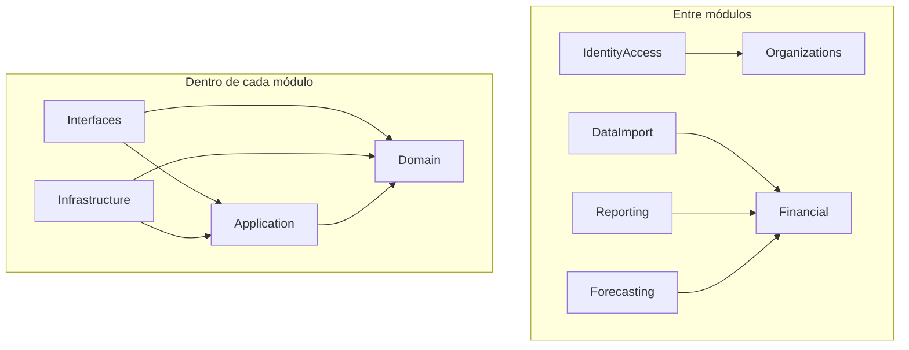

# Arquitetura da API

Índice consolidado na issue [#18](https://github.com/mamura/bacurim-api/issues/18), parte da #12. A API é um monólito modular Laravel com quatro camadas por módulo, contextos definidos a partir dos documentos de produto e implantação única.

## Documentação

| Tema | Referência |
| --- | --- |
| Contextos, responsabilidades e dependências sem ciclos | [Mapa dos contextos](context-map.md) |
| Domain, Application, Infrastructure e Interfaces | [Camadas e dependências](architecture-layers.md) |
| Diretórios, namespaces e inclusão de novos módulos | [Estrutura modular](modular-structure.md) |
| Providers, bindings, contratos públicos e eventos | [Integração entre módulos](module-integration.md) |
| Shared Kernel, contexto e isolamento de tenant | [Shared Kernel e tenancy](shared-kernel-and-tenancy.md) |
| Decisões de modularização | [ADR-0001](adr/0001-modular-monolith.md) |
| Decisões de camadas e composição | [ADR-0002](adr/0002-layers-and-composition.md) |
| Decisões de contexto e compartilhamento | [ADR-0003](adr/0003-explicit-tenant-context.md) |
| Execução e infraestrutura local | [Ambiente Docker](development-environment.md) |

## Diagrama de dependências

Setas representam dependências de código ou contratos, não chamadas de rede:



A composição conecta contratos e implementações no bootstrap/provider; ela é a exceção explícita que conhece adaptadores e entradas. Não autoriza inversões de dependência dentro do código de negócio. O Shared Kernel futuro permanece independente de framework e módulos, conforme a #17.

## Exemplo técnico executável

O exemplo em `tests/Fixtures/Architecture` reproduz as quatro camadas sem adicionar regra financeira ou funcionalidade à aplicação:

| Arquivo relativo ao fixture | Papel |
| --- | --- |
| `Domain/ProbeStatus.php` | Enum puro que representa os dois estados do exemplo. Não verifica infraestrutura real. |
| `Application/Contracts/AvailabilityProbe.php` | Porta de leitura consumida pelo caso de uso. |
| `Application/ReadProbeStatus.php` | Caso de uso com dependência recebida por construtor. |
| `Infrastructure/InMemoryAvailabilityProbe.php` | Implementação em memória para o exemplo. |
| `Infrastructure/Providers/ArchitectureExampleServiceProvider.php` | Binding explícito entre porta e adaptador. |
| `Interfaces/Http/ProbeStatusController.php` | Tradução da saída do caso de uso em JSON. |

`tests/Feature/ArchitectureExampleTest.php` registra o provider e uma rota apenas na aplicação de teste. O primeiro teste verifica o adaptador resolvido e a chamada HTTP por todas as camadas. O segundo substitui a implementação da porta e verifica que o caso de uso passa a retornar o novo resultado sem alteração de código.

A rota `/_architecture/probe` não consta em `routes/` nem o provider em `bootstrap/providers.php`. Os fixtures usam o autoload de desenvolvimento `Tests\`; não são um módulo de negócio, não exercitam tenant real e não mudam o contrato do health check. O estado simulado não é um health check de PostgreSQL/Redis.

## Executar a validação

Na raiz do workspace:

```bash
docker compose exec api composer dump-autoload --optimize --strict-psr
docker compose exec api php artisan test --filter=ArchitectureExampleTest
docker compose exec api composer test
docker compose exec api vendor/bin/pint --test
docker compose exec api php artisan route:list
```

O autoload deve resolver os fixtures sem violações PSR-4, os dois testes do exemplo devem passar e a rota do exemplo não deve aparecer na listagem da aplicação normal. A suíte completa mantém os testes existentes da API.

## Estado e limites da fundação

Os seis módulos existem como estrutura inicial sem implementação de domínio; portanto não há imports de implementações entre módulos nem ciclos atuais. As regras de integração estão documentadas e o exemplo valida composição e substituição de adaptadores. Isso não equivale a uma verificação automática completa de fronteiras: os testes de arquitetura previstos na #30 deverão verificar código real conforme ele surgir.

Não foram criados casos de uso financeiros, tabelas financeiras, autenticação, resolução de tenants, pacote de módulos, banco por tenant, CQRS obrigatório ou mensageria distribuída. A arquitetura deverá evoluir a partir dos fluxos reais, preservando as invariantes de produto e registrando mudanças relevantes em novos ADRs.

Voltar ao [README](../README.md).
