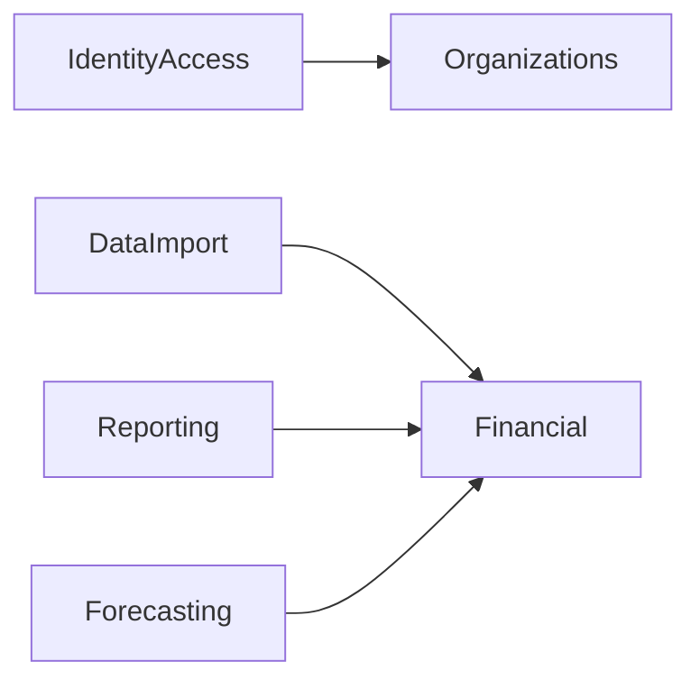

# Mapa dos contextos do Bacurim

Definição inicial da issue [#13](https://github.com/mamura/bacurim-api/issues/13), parte da arquitetura da issue [#12](https://github.com/mamura/bacurim-api/issues/12). Os limites abaixo orientam a implementação incremental do monólito modular. Este documento não implementa funcionalidades financeiras nem cria entidades, tabelas ou módulos vazios.

## Referências de produto

Documentos consultados na pasta de produto disponibilizada em `C:/Users/mamur/OneDrive/Documentos/Mamura/Bacurim`:

- `Product Definition/08 - MVP Definition.md`: jornada Organizar → Entender → Antecipar; capabilities de importação, compreensão de resultado e projeção conhecida de 12 meses.
- `Product Definition/09 - MVP Features.md`: contas, categorias, eventos, compromissos, realizações, importação, relatórios, projeção, acesso e exportação.
- `Product Definition/10 - Domain Model.md`: conceitos econômicos e financeiros; seções 5.1–5.6 sobre tenant e usuário; relações entre evento, compromisso, realização e movimentação.
- `Product Definition/11 - Business Rules.md`: invariantes BR-001 a BR-075, incluindo histórico, transferências, projeção e isolamento.
- `Planejamento.md`: sequência API-M1 a API-M7 para identidade, núcleo financeiro, ciclo de vida, compromissos, importação, inteligência e projeção.

Esses documentos compõem a referência de produto mencionada como Product Blueprint no backlog. A landing é material de comunicação e não substitui as definições do domínio. Os arquivos originais permanecem fora deste repositório; este mapa registra a síntese necessária à engenharia, sem alterá-los.

## Decisão de modularização

Adotar seis módulos lógicos: `IdentityAccess`, `Organizations`, `Financial`, `DataImport`, `Reporting` e `Forecasting`. São limites de responsabilidade, não seis serviços ou seis bancos. A criação física será tratada na #15, sem antecipar funcionalidades dos milestones seguintes.

Contas financeiras e transações ficam no mesmo módulo `Financial`, com áreas internas distintas. Separá-las em módulos agora distribuiria as invariantes de realização, movimentação, transferência e saldo entre módulos mutuamente dependentes. Parcelamentos e recorrências também ficam nesse núcleo porque geram eventos e compromissos sujeitos às mesmas regras de consistência e histórico.

Importação, interpretação de resultados e projeção estão no MVP. Sua implementação é incremental conforme o planejamento, sem transformar adiamento técnico em exclusão do escopo do produto.

## Responsabilidades e limites

| Módulo | Responsabilidade e conceitos próprios | Fora de sua responsabilidade | Entrega incremental |
| --- | --- | --- | --- |
| `Organizations` | Empresa, ciclo de vida e configuração do tenant; relação de um tenant com exatamente uma empresa no MVP. Disponibiliza consultas públicas sobre a existência e situação desse contexto. | Credenciais, autenticação, permissões dos usuários e dados financeiros. Não contém carteira multiempresa ou identidade global. | API-M1 |
| `IdentityAccess` | Usuários pertencentes a um tenant, autenticação e autorização nesse contexto. Consulta contratos públicos de Organizations quando precisar validar o tenant. | Configuração financeira da empresa, cadastro de contas, cálculo de saldos e acesso global a tenants. Consultor é usuário autorizado comum, sem experiência especializada. | API-M1 |
| `Financial` | Contas, categorias, eventos econômicos, compromissos, realizações, movimentações, transferências, distribuições, parcelamentos, recorrências e operações de correção histórica. Mantém as invariantes e fornece consultas públicas de fatos e posição financeira. | Autenticação, leitura de arquivos, apresentações de relatórios e cálculo da projeção de 12 meses. Não calcula tributos automaticamente nem implementa escrituração contábil. | API-M2, M3 e M4 |
| `DataImport` | Arquivos CSV/planilha, mapeamento, preparação, validação de formato, pré-visualização e controle de confirmação dos dados importados. Registra a origem da importação. | Não grava diretamente na persistência financeira nem substitui suas validações. Confirma dados por operações públicas de Financial. Integrações bancárias e ERPs ficam fora do MVP. | API-M5 |
| `Reporting` | Resultado por competência, leitura de caixa, composição, comparação temporal, indicadores, visão empresa × proprietário e exportação dos principais dados. Mantém a rastreabilidade aos fatos consultados. | Não modifica fatos financeiros, não redefine a natureza de pró-labore/distribuições e não cria uma cópia autoritativa do domínio. | API-M6 |
| `Forecasting` | Projeção de 12 meses derivada da posição atual e dos compromissos conhecidos; detalhamento e rastreabilidade da projeção. | Não detém compromissos, parcelamentos ou recorrências. Não altera suas origens nem trata eventos desconhecidos, cenários hipotéticos ou modelos estatísticos como fatos. | API-M7 |

Onboarding e dashboards são jornadas que podem compor operações desses módulos. Não justificam novos contextos de domínio. Histórico e responsabilidade das alterações pertencem ao módulo dono dos fatos; não criar um módulo genérico de auditoria para retirar essas invariantes de Financial.

## Organização interna do núcleo financeiro

As áreas abaixo representam vocabulário e responsabilidades internas, sem obrigar um diretório ou agregado por item:

| Área | Responsabilidade | Invariantes de referência |
| --- | --- | --- |
| Contas e categorias | Cadastro de disponibilidades e classificação gerencial, preservando referências históricas. | BR-039 a BR-045; Domain Model §§6 e 21 |
| Eventos econômicos | Receitas, custos, despesas, competência e origem econômica, incluindo pró-labore como despesa. | BR-001 a BR-006; BR-051 a BR-054 |
| Compromissos | Obrigações/direitos, vencimentos, parcelas e saldo pendente. Vencido é condição temporal independente da situação de realização. | BR-007; BR-014 a BR-022; BR-028 a BR-032 |
| Realizações e movimentações | Pagamentos/recebimentos, transferências equilibradas, distribuição ao proprietário, estornos e ajustes com preservação do fato original. | BR-008 a BR-017; BR-023 a BR-027; BR-046 a BR-058 |
| Recorrências | Regras que geram novas ocorrências independentes, mantendo horizonte prioritário de 12 meses. Não confundir com parcelamento. | BR-033 a BR-038 |

A separação conceitual entre evento econômico, compromisso, realização e movimentação é preservada mesmo dentro de um único módulo. Um módulo não é uma entidade ou um agregado único. Limites transacionais e agregados serão definidos nos casos de uso concretos; a fundação não cria um banco de entidades genéricas antecipadamente.

## Mapa de dependências permitidas

A seta representa consumo de contrato público do módulo de destino, sem importar sua implementação interna:

Não existem arestas de retorno nesse mapa. Financial não depende de importadores, relatórios ou projeções. Organizations não depende de IdentityAccess: quando criar empresa e usuário fizer parte da mesma jornada, uma composição explícita de aplicação chama as operações públicas necessárias; não introduzir chamadas recíprocas entre os módulos.

O contexto de tenant autorizado é uma entrada explícita das operações financeiras. Essa passagem de dados não cria uma dependência de Financial com os serviços de autenticação. A localização das abstrações de contexto e os mecanismos de autorização serão detalhados na #17 e no API-M1.

Reporting e Forecasting consultam contratos de leitura de Financial que retornam dados suficientes para preservar origem e consistência. Caso uma tela precise de ambos, a composição acontece na entrada da aplicação; Reporting e Forecasting não passam a depender um do outro.

## Contratos e comunicação

- Um módulo é dono das mudanças de estado de seus conceitos; outros módulos não importam suas entidades, modelos Eloquent, tabelas ou repositórios internos.
- Contratos públicos expõem operações e dados de entrada/saída estáveis. A estrutura de namespaces, os providers e os bindings serão definidos nas #14 a #16.
- DataImport confirma dados por operações de Financial. Uma pré-validação de arquivo não garante aceitação posterior: Financial continua responsável pelas invariantes no momento da confirmação.
- Reporting e Forecasting recebem fatos ou projeções de leitura pelos contratos públicos de Financial. As fórmulas de interpretação e projeção pertencem a seus respectivos módulos; as regras sobre o que é um fato realizado permanecem em Financial.
- Exportação inicial é uma capacidade de leitura de Reporting, sem novo módulo. Caso exija comportamento próprio no futuro, revisar essa decisão.
- Leitura direta de tabelas de outro módulo não é permitida por conveniência. Uma otimização futura exige decisão explícita que preserve isolamento, contrato e responsabilidade pelos dados.
- Eventos só serão introduzidos quando houver uma necessidade concreta de integração. A existência de dependências síncronas permitidas não obriga eventos, filas, CQRS ou mensageria distribuída.

## Conceitos compartilhados e tenant

No MVP, um tenant está associado a uma empresa e pode conter vários usuários. Cada usuário pertence a um único tenant. Não há identidade global, alternância entre tenants ou carteira de clientes do consultor. Empresa é entidade de negócio; tenant é a fronteira de isolamento e não deve ser tratado como sinônimo de empresa, apesar da relação 1:1 atual (Domain Model §5).

Toda operação com dados financeiros, incluindo importação, relatórios, projeções, exportação e processamento em segundo plano, exige contexto de tenant conhecido e autorizado. Referências a contas, categorias, compromissos e realizações devem pertencer ao mesmo tenant. Conhecer o identificador de um registro não autoriza seu acesso (BR-071 a BR-075).

Identificadores de tenant e do ator podem atravessar contratos como dados explícitos; não transportar entidades de usuário/empresa ou modelos ORM entre módulos. Um Shared Kernel só receberá abstrações mínimas quando houver uso demonstrável. Valores monetários, moedas e períodos não entram automaticamente nele por serem usados em várias telas. A definição desses contratos cabe à #17.

O mapa não decide banco por tenant, schema por tenant ou tabelas compartilhadas. O Domain Model deixa a estratégia técnica para a arquitetura; essa decisão não pode ser inferida apenas pela existência de um PostgreSQL no ambiente local.

## Decisões sobre os candidatos da #13

| Candidato original | Decisão inicial | Justificativa |
| --- | --- | --- |
| Identity & Access | `IdentityAccess` | Acesso é responsabilidade própria e sempre pertence ao tenant no MVP. |
| Organizations | `Organizations` | Empresa e fronteira de tenant têm responsabilidade própria, separada de credenciais e finanças. |
| Financial Accounts | Área interna de `Financial` | Movimentações, transferências e saldos exigem invariantes coordenadas. |
| Financial Transactions | Núcleo de `Financial` | Agrupa o ciclo econômico e financeiro sem confundir seus conceitos. |
| Financial Planning | Recorrências/parcelas em `Financial`; projeção em `Forecasting` | O MVP distingue geração de compromissos de análise derivada de futuro conhecido. Não há módulo genérico de orçamento/cenários. |
| Financial Reporting | `Reporting` | A leitura e interpretação de fatos não devem se tornar donas das alterações financeiras. |
| Data Import | `DataImport` | Importação assistida está no MVP e tem ciclo de preparação/validação próprio. |

## Critérios de revisão

Revisar esses limites quando invariantes ou fluxos reais demonstrarem responsabilidade autônoma, necessidade de contrato adicional ou dependência circular. Não separar módulos apenas por tela, tabela ou milestone. A sequência de entrega do Planejamento não determina fronteiras do domínio.

A questão de arquitetura e estrutura (#12) permanece em andamento. Este mapa cobre a #13; camadas, diretórios, injeção de dependências, Shared Kernel e exemplo técnico pertencem às #14 a #18. A estratégia final deve ser registrada em ADRs durante essa sequência.
